<p align="center">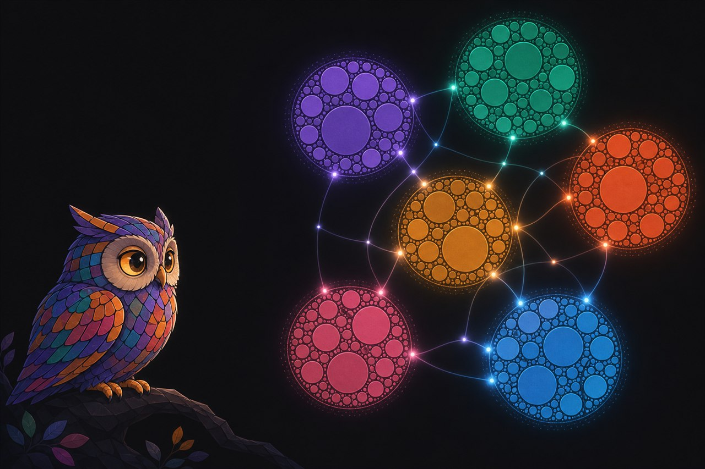</p>

<h1>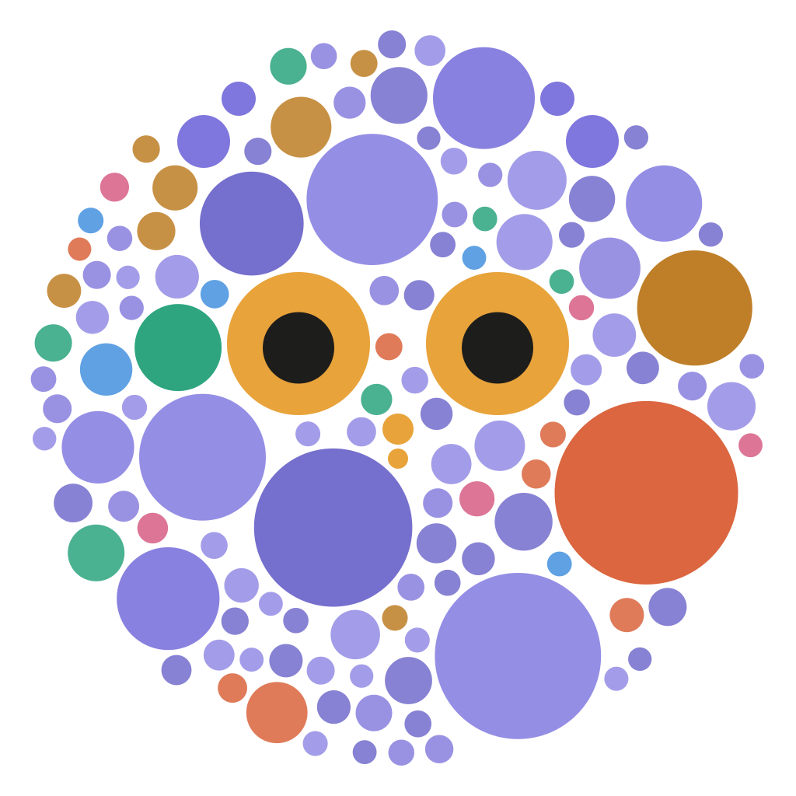 Tessera</h1>

**See what you actually do with Claude.**


Tessera reads your Claude Code sessions, Claude desktop (Cowork) sessions and claude.ai
chats on your own machine, and turns them into one zoomable map: a few big headlines
that sum up your life and work, the projects inside them, every single activity, and the
methods that connect them. Each session is one tile; Tessera puts the mosaic together.

- **Local.** Your logs never leave your machine except through your own Claude.
- **No API key needed.** Runs as a Claude Code plugin on your own plan.
- **Redacted.** Credentials drop the whole session; hosts, IPs, emails and paths are
  replaced before Claude reads anything, and the map refers to people by role, not name.
- **Honest.** Every activity traces back to a session. Nothing is invented, nothing is posted.

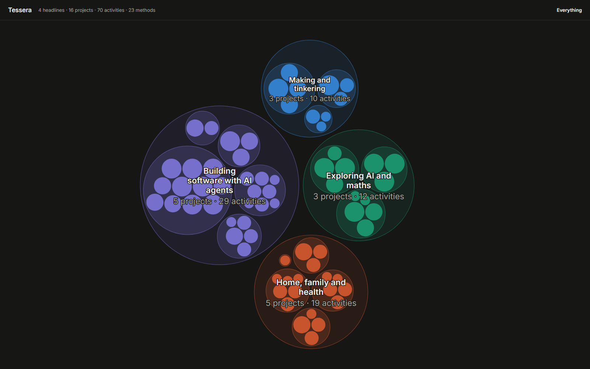

## Don't trust it? Let your own Claude check it first

Tessera reads your Claude sessions, so you should know what it does before you install it.
Paste this into Claude Code or the desktop app's Code tab, in an empty folder. Claude
downloads the code, runs none of it, and reports back:

```
Download the repository fsaritome/Tessera from GitHub with git into ./tessera-review and
do not run, install or import anything from it. Review it as a security auditor and tell me in plain words:
1. Which files and folders on my computer it reads, and which it writes.
2. Every network connection it can make, to where, and when.
3. What the plugin (.claude-plugin/, skills/) lets Claude run, and with which permissions.
4. What can leave my computer, and through which path.
5. Anything that runs on its own: hooks, MCP servers, install or build scripts.
6. Anything suspicious, risky or worth fixing.
Quote file and line for every claim. Then check the tag v0.2.2 is the same code you read.
```

To install exactly the version you checked, use the marketplace with its version tag,
`fsaritome/Tessera#v0.2.2` instead of `fsaritome/Tessera`, in the terminal commands below.
A tagged version never changes, even if the repository does later.

## Install

Pick the way you use Claude: **A** in the Claude desktop app (no terminal except one line
for uv), or **B** in a terminal.

**First, in both cases: get [uv](https://docs.astral.sh/uv/getting-started/installation/)**,
the small tool that runs Tessera. Paste this once into a terminal (PowerShell on Windows,
Terminal on Mac or Linux), then close that terminal:

| Windows (PowerShell) | Mac and Linux |
|---|---|
| `powershell -ExecutionPolicy ByPass -c "irm https://astral.sh/uv/install.ps1 \| iex"` | `curl -LsSf https://astral.sh/uv/install.sh \| sh` |

### A. In the Claude desktop app

**1. Add the marketplace.** Open **Settings → Customize → Plugins**, click **+ Add** at
the top right and choose **Add marketplace**:

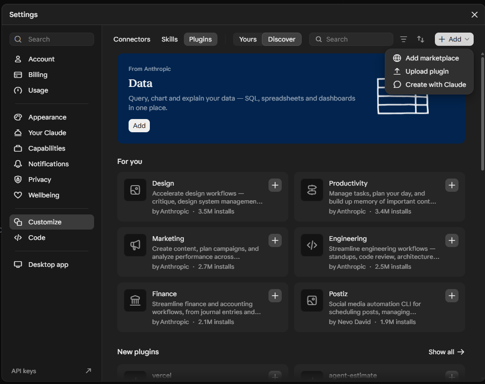

**2. Enter `fsaritome/Tessera`** and click **Sync**:

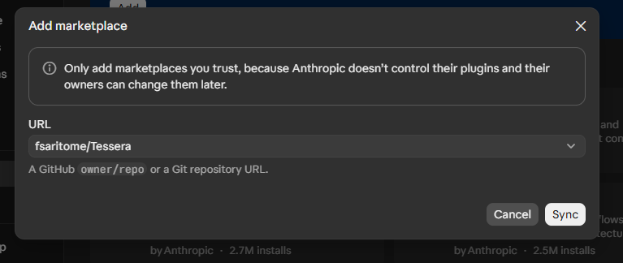

**3. Click "Add to this computer"** next to Tessera. Tessera reads the sessions on your
computer, so it has to be installed there:

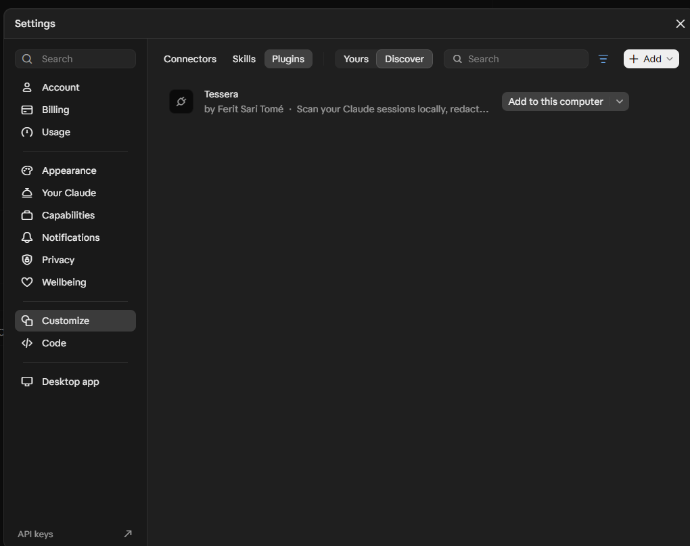

**4. Make your map.** Start a new session in the **Code** tab, with any folder of your own,
type `/tessera:map` and press Enter:

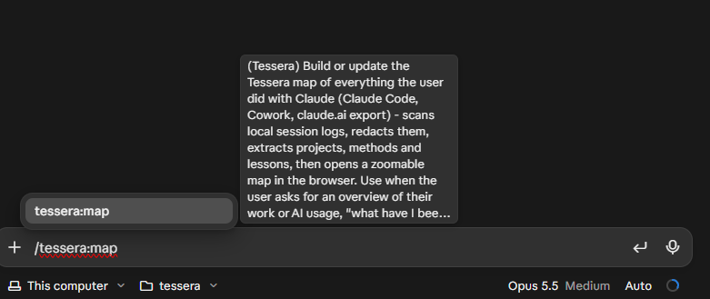

Claude then works through the same steps as in the terminal, see [what you will see](#what-you-will-see).

### B. In a terminal

**1. Get [Claude Code](https://code.claude.com/docs/en/quickstart)** (once):

| Windows (PowerShell) | Mac and Linux |
|---|---|
| `irm https://claude.ai/install.ps1 \| iex` | `curl -fsSL https://claude.ai/install.sh \| bash` |

Then **close the terminal and open a new one**, so `claude` and `uv` are found. Type
`claude` once and sign in with your Claude account.

**2. Add Tessera** with one command in the terminal:

```
claude plugin install tessera --marketplace fsaritome/Tessera
```

Already inside Claude Code? Type these instead, one at a time. The second one opens a
small menu where **"Install for you (user scope)"** is already selected: press Enter.

```
/plugin marketplace add fsaritome/Tessera
```
```
/plugin install tessera@tessera
```

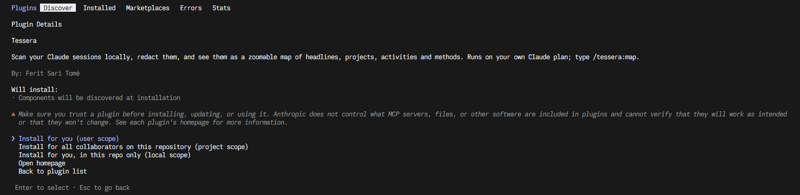

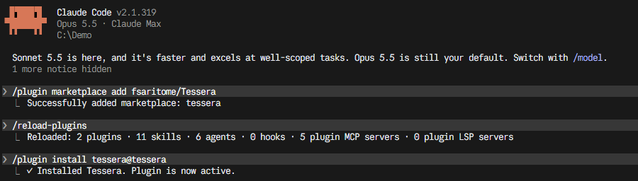

If Claude Code suggests `/reload-plugins`, type it. If it asks whether you trust the
folder you started it in, that is its normal first-start check.

**3. Make your map.** Start `claude` and type:

```
/tessera:map
```

### What you will see

Claude scans your sessions of the last 30 days and tells you how many batches it will
read and what that costs, before it starts:

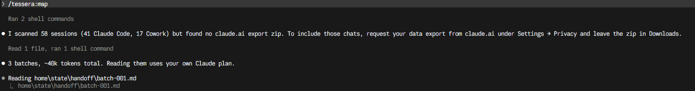

You will see Claude write its answers for each batch; that is normal. A few minutes later:

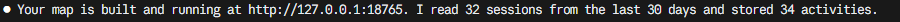

Open http://127.0.0.1:18765 in your browser. Run `/tessera:map` again any time: sessions
it has already read are never read again. `/tessera:map 365` adds the rest of the year.

### Update or remove

- **Desktop app:** Tessera is listed under **Settings → Customize → Plugins → Yours**.
- **Terminal:** update with `claude plugin marketplace update tessera` and then
  `claude plugin update tessera@tessera`; remove with `claude plugin uninstall tessera@tessera`.
- Delete the `.tessera` folder in your home folder to remove Tessera's data too.

## What it costs

Tessera itself is free, but Claude reads your sessions **on your own Claude plan**, so it
uses your plan's limits like any other work in Claude Code. Before reading, Tessera shows
the number of batches and an estimate. It is counted on your computer, needs no API key and
sends nothing; its ratio of characters to tokens was measured with Anthropic's token
counter. The real run in the pictures above was 30 days on one computer: 58 sessions,
3 batches, about 60,000 tokens, done in under four minutes. (The picture still shows the
older, too low estimate of 40k.)

A batch is up to about 20,000 tokens. With more than 15 batches, Claude asks you
before it starts, so a heavy year of use (dozens of batches) never runs by surprise.
Start with the default 30 days and add more once you like the map. Later runs only read
what is new.

## If something goes wrong

| What you see | What to do |
|---|---|
| `claude` or `uv` is "not recognized" / "command not found" | Close the terminal and open a new one. On Windows, if `claude` is still missing, add `%USERPROFILE%\.local\bin` to your PATH (the installer prints this). |
| Claude Code asks whether you trust the folder | Normal first-start check. Choose "Yes" for a folder of your own, e.g. your home folder. |
| `/tessera:map` is unknown | Type `/reload-plugins`. If that does not help, run the two `/plugin` commands again. |
| Install or update fails: "could not be replaced: it is in use" | An open Tessera map from version 0.2.0 or older holds the folder. Close the Claude Code window that started it (or restart your computer), then install again. From 0.2.1 on this cannot happen. |
| "Nothing to do" | Everything in the time window is already read. `/tessera:map 365` looks further back. |
| The map page does not open | Claude starts it at the end; ask it "open the Tessera map" or run `/tessera:map` again. |
| You want to start over | Delete the `.tessera` folder in your home folder. |

## What the map shows

A real map of one person's sessions in share mode: side projects, home and learning.
Zoom in by clicking or scrolling, light up a method to see where you used it:

| Zoom into a headline | Light up a method |
|---|---|
| 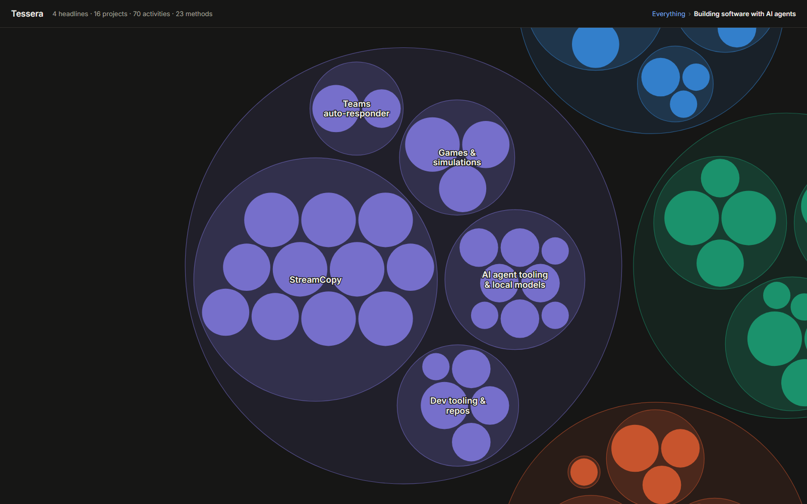 | 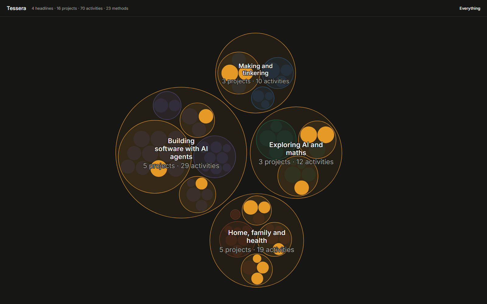 |

| Zoom level | What you see |
|---|---|
| Overview | 4-7 headlines Claude writes from your actual topics, e.g. "Building tools with AI agents" |
| Headline | The projects behind it, with a one-line summary each |
| Project | Every activity: what you did, how, what came of it, the lesson |
| Methods | Click a method ("Scoped access for AI agents", "Research before building") and every activity that uses it lights up across all headlines |

Headlines are not fixed categories. They are rewritten when new work arrives, while the
existing ones are kept where they still fit, so your map stays stable but can grow.

### Showing your map to others

`tessera map --share` leaves out projects you marked as your job and every activity
Claude did not mark as shareable, and drops the summaries. Links open a fixed view, handy
for screenshots:

| Parameter | Example | Effect |
|---|---|---|
| `focus` | `?focus=Headline/Project` | Opens zoomed into a headline or project |
| `method` | `?method=Research before deciding` | Lights up one method |
| `theme` | `?theme=light` | `dark` or `light` |
| `panel` | `?panel=0` | Map only, no side panel |

Screenshots are pictures: look at every label before you post one.

## Where the data comes from

| Source | How it is found |
|---|---|
| Claude Code | `~/.claude/projects/` (all platforms) |
| Claude desktop (Cowork) | The desktop app's local session folder, found automatically |
| claude.ai chats | Your [data export](https://claude.ai/settings/data-privacy-controls): leave the zip in Downloads, Tessera finds it |
| git (optional) | Repos you list in the settings: your commit messages and stats |

Read: your prompts, session titles, tool names and edited file names. Not read: Claude's
replies and tool output.

## Without Claude Code

Tessera is also a normal command-line tool:

```bash
uv tool install git+https://github.com/fsaritome/Tessera
tessera scan
tessera extract --engine api      # your own key in ANTHROPIC_API_KEY; --dry-run shows the cost first
tessera merge --engine api
tessera map
```

`--engine local` uses an OpenAI-compatible model on your machine instead
(`TESSERA_LLM_URL=http://localhost:11434/v1`, `TESSERA_LLM_MODEL=...`).

## Privacy and safety

- **Credentials:** a password, key, token or connection string anywhere in a session
  drops the whole session.
- **Redaction:** IPs, hostnames, internal domains, user paths, network shares, emails,
  phone numbers, VLANs, firewall rules, amounts and company names with a legal form
  (GmbH, Inc, Ltd ...) are replaced with placeholders like `[Host]` before any model
  sees them. Add rules for your own reference numbers in
  `~/.tessera/config/redact/extra-rules.yaml` (same format as the default rules). Rules catch patterns, not every name: see your own lists below.
- **Your own lists:** add client, colleague or host names to
  `~/.tessera/config/redact/terms/*.txt` (one per line) to replace them too, and use
  `tessera suggest` to see what still gets through.
- **Confidential work:** projects or topics you list under `sensitive` only ever show a
  generic description.
- **Your plan, your credentials:** the plugin runs inside your own, unmodified Claude Code.
  Tessera never reads, stores or uses your Claude login.
- **Delete everything:** remove `~/.tessera`.

## Settings

Optional, in `~/.tessera/config/settings.yaml` (defaults are in
[`src/tessera/defaults/settings.yaml`](src/tessera/defaults/settings.yaml)):

```yaml
profile:
  about: Platform engineer, also builds synths and runs a small bakery.
internal_domains: [example-corp.com]
sensitive:
  projects:
    Client X migration: Infrastructure migration for a client
sources:
  git:
    repos: [~/code/my-tool]
```

## Commands

| Command | What it does |
|---|---|
| `tessera scan` | Find and read new sessions |
| `tessera status` | What is scanned, extracted and merged |
| `tessera prepare` / `import` | Batches for Claude Code and checking its answers (used by the plugin) |
| `tessera extract --engine api\|local` | Extract without Claude Code |
| `tessera merge` | Headlines, projects and methods |
| `tessera map [--share]` | Open the map (`--share`: only what you would show others) |
| `tessera suggest` | Names and hosts that still get through redaction |
| `tessera check-redact "text"` | Try the redaction rules on any text |

## Limits

- The Claude desktop app's session folder is not a documented format. If an app update
  changes it, Tessera skips what it cannot read instead of failing.
- claude.ai chats only arrive through the data export.
- Works on Windows, macOS and Linux; the tests run on all three for every change. The
  Claude desktop app (and with it Cowork) does not exist for Linux, so there Tessera reads
  Claude Code sessions and claude.ai exports only.

## License

MIT. Tessera is an independent project and is not affiliated with or endorsed by
Anthropic. Claude and Claude Code are trademarks of Anthropic.
